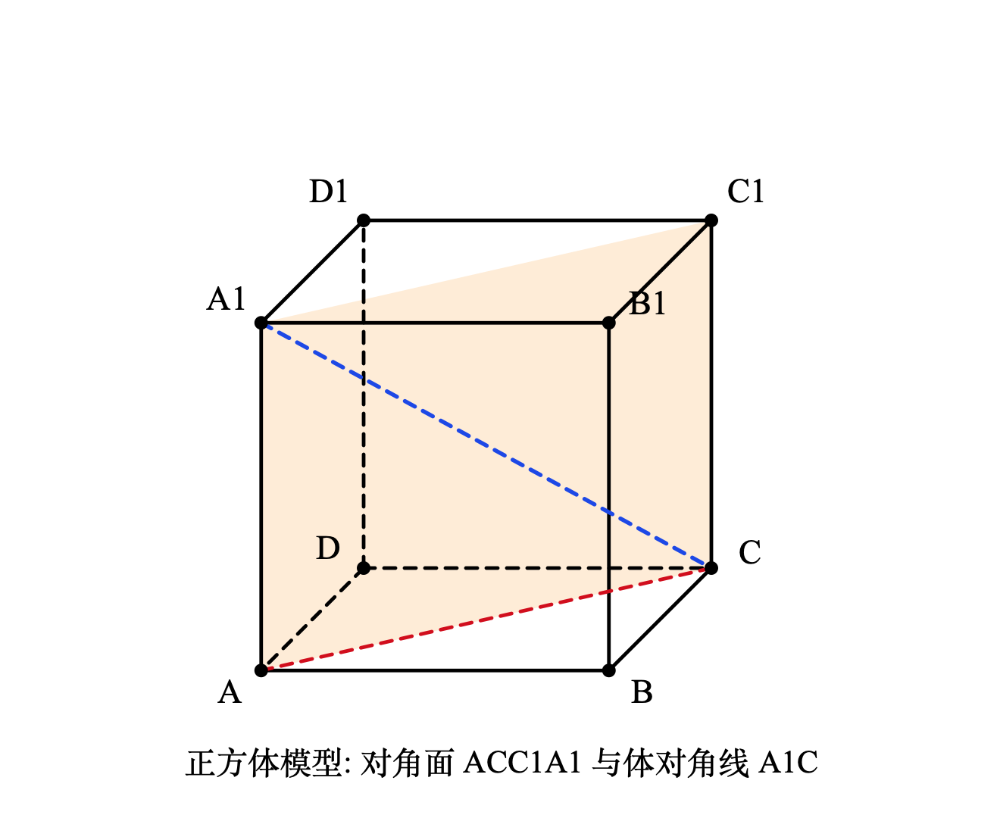
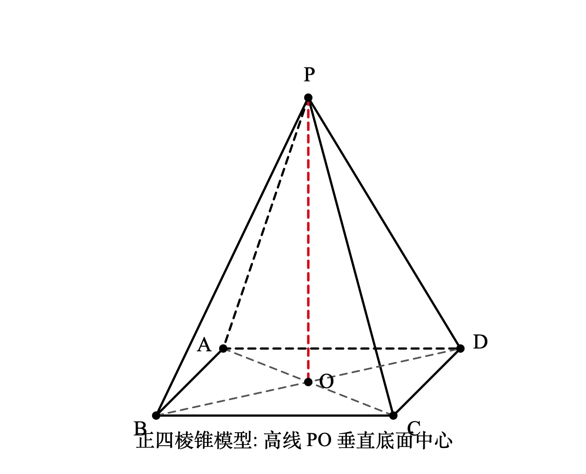
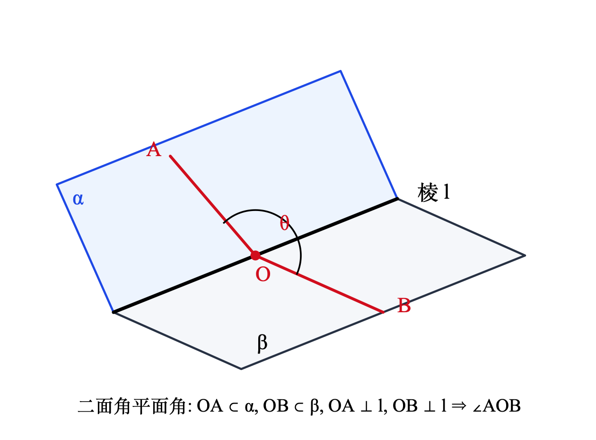
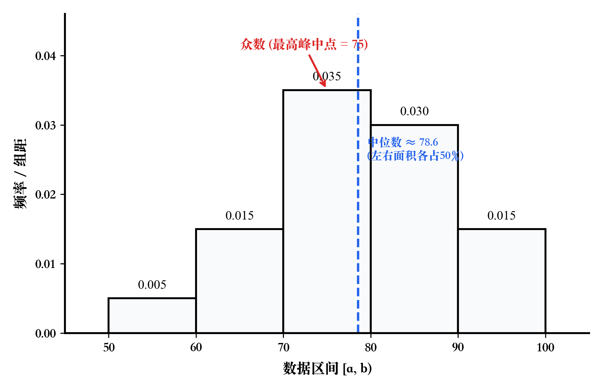
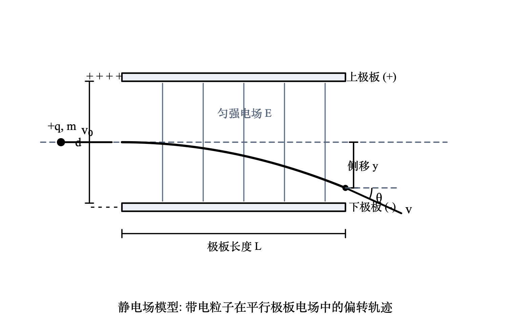
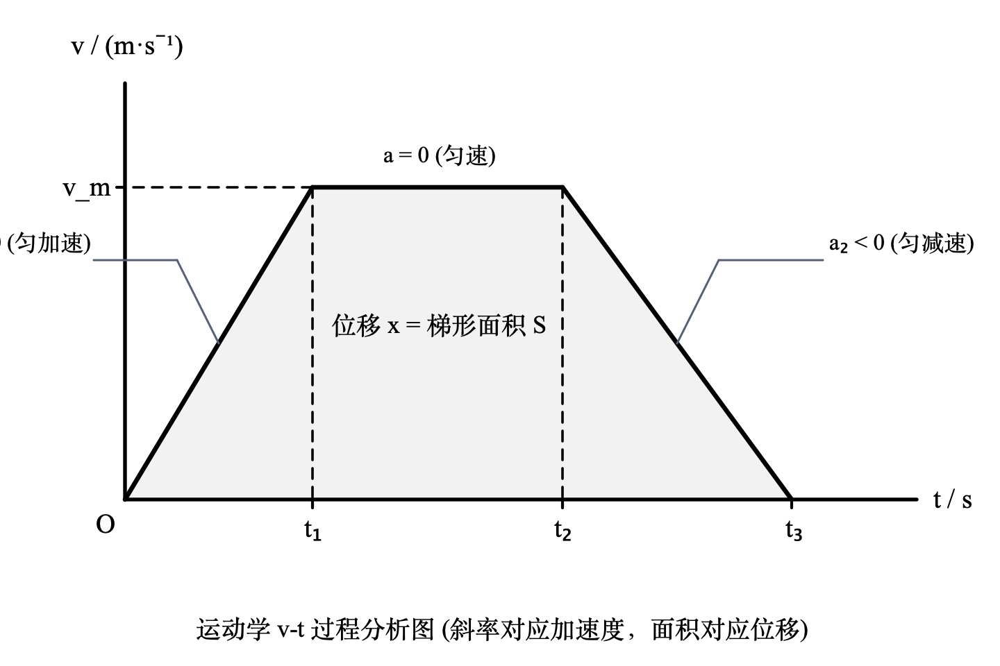

# math-graphics

> **中国高中数理高考试卷标准矢量题图与立体几何绘制引擎**  
> 纯 Python 标准库零三方依赖 + macOS 原生 AppKit 300+ DPI 印刷级光栅化渲染 + 完整 CLI 与 MCP (Model Context Protocol) 协议支持。

---

## 🌟 核心特性

* **高考试卷制图标准**：严格遵循中国高中数学教材与高考试卷印刷规范，内置立体几何**斜二测画法**（$45^\circ$ 轴倾角、长减半、空间可见性虚实线自动绘制、点位规范偏移）。
* **纯 Python 标准库实现**：核心计算与 SVG 矢量生成逻辑 **零外部依赖**（无须安装 `numpy`、`matplotlib` 等大型科学计算库）。
* **macOS 原生超高清渲染**：直接调用系统底层 AppKit / Swift 桥接渲染器，实现 300+ DPI 印刷级 PNG 光栅化，无边缘锯齿与字体失真。
* **AI Agent 原生集成 (MCP Server)**：原生遵循 Model Context Protocol 规范，可直接挂载至 Antigravity、Claude Code、Cursor 作为专属数学绘图工具。
* **丰富预设图库**：覆盖立体几何（多面体及任意截面、折叠四面体、截角正方体）、平面几何与定理、统计分布直方图、高中物理核心运动模型。

---

## 🖼️ 样例展示

| 正方体对角截面 (斜二测画法) | 正四棱锥 $P-ABCD$ | 二面角平面角模型 |
| :---: | :---: | :---: |
|  |  |  |

| 频率分布直方图 | 带电粒子在电场中的偏转 | 速度-时间 ($v-t$) 图像 |
| :---: | :---: | :---: |
|  |  |  |

---

## 📐 系统架构

```text
math_graphics/
├── core/
│   ├── canvas.py          # SVGCanvas: 点、线、虚线、折角、圆弧、数学字体标注
│   ├── projection.py      # StereoEngine: 斜二测画法 (Axonometric) 3D -> 2D 投影
│   └── renderer.py        # Swift/AppKit 原生 300+ DPI 印刷级 PNG 光栅化渲染
├── models/
│   ├── solids.py          # 标准多面体：正方体/长方体(任意截面)、三棱柱、四棱锥、自定义几何体
│   ├── complex_solids.py  # 复合多面体：异形翻折四面体、截角八面/正方体
│   ├── plane.py           # 平面：向量加减/数量积、正弦外接圆、立体几何 8 大核心定理
│   ├── stats.py           # 统计与概率：频率分布直方图、正态分布密度曲线、古典概型树状图
│   └── physics.py         # 物理模型：v-t 图、伏安特性曲线、带电粒子偏转轨迹
├── cli.py                 # 统一命令行入口 (CLI)
├── mcp_server.py          # MCP 标准服务端 (JSON-RPC 2.0 over stdio)
├── examples/              # 高清样例矢量图与渲染图
├── scripts/               # 批量生成全图库辅助脚本
└── tests/
    └── test_encapsulation.py # 自动化测试套件
```

---

## 🚀 快速上手

### 1. 本地安装
```bash
git clone https://github.com/ZHUOLIN0928/math-graphics.git
cd math-graphics
pip install -e .
```

### 2. 命令行 (CLI) 调用

#### 立体几何多面体生成
```bash
# 生成正方体并绘制截面 A-C-C1-A1，同时输出高清 PNG
math-graphics solid --shape cube --section A,C,C1,A1 --png -o cube_cut.svg

# 生成直三棱柱
math-graphics solid --shape prism --png -o tri_prism.svg

# 生成正四棱锥 P-ABCD
math-graphics solid --shape pyramid --png -o pyramid.svg
```

#### 平面向量与解三角形
```bash
# 向量加法 (平行四边形法则)
math-graphics plane --type vector-add --png -o vec_add.svg

# 正弦定理与外接圆模型
math-graphics plane --type triangle-sine --png -o triangle_sine.svg
```

#### 立体几何核心定理 (geo_01 ~ geo_08)
```bash
# 生成二面角平面角模型 (geo_07)
math-graphics theorem --id geo_07 --png -o dihedral.svg
```

#### 批量生成全套高考题图
```bash
math-graphics batch-all -d ./output_figures
```

---

## 🤖 Model Context Protocol (MCP) 服务端接入

本工具原生内置遵循 MCP 标准规范的服务端（JSON-RPC 2.0 over stdio），可无缝接入 Antigravity、Claude Code、Cursor 等 Agent 体系。

### 客户端注册配置 (`mcp_config.json`)
```json
{
  "mcpServers": {
    "math-graphics": {
      "command": "math-graphics-mcp"
    }
  }
}
```

### 暴露的 MCP Tools

| 工具名称 | 功能描述 |
| :--- | :--- |
| `render_solid_geometry` | 参数化生成正方体/三棱柱/四棱锥，支持指定任意多边形截面 |
| `render_plane_geometry` | 生成平面向量、解三角形外接圆与测高测角图 |
| `render_theorem_diagram` | 生成立体几何线面平行/垂直、面面平行/垂直、二面角等核心定理图 |
| `render_custom_polyhedron` | 接收任意 3D 空间顶点与连线，按斜二测画法投影渲染自定义几何体 |
| `render_histogram` | 生成带有组距、频数、中位数与众数标注的高考频率分布直方图 |
| `render_svg_to_png` | 调用系统底层高精度渲染管线将任意 SVG 转为 300+ DPI 印刷级 PNG |

---

## 💻 Python API 代码调用

```python
from math_graphics import build_cube, render_svg_to_png

# 1. 构造带截面正方体模型
cv = build_cube(
    a=1.5, b=1.8, c=1.8,
    section=["A", "C", "C1", "A1"],
    title="正方体对角面截面模型"
)
svg_path = cv.save("cube_section.svg")

# 2. 渲染为 300+ DPI 印刷级 PNG
png_path = render_svg_to_png(svg_path, scale=3.0)
print(f"印刷级图像已生成: {png_path}")
```

---

## 📄 开源许可证

本项目采用 [MIT 许可证](LICENSE)。
